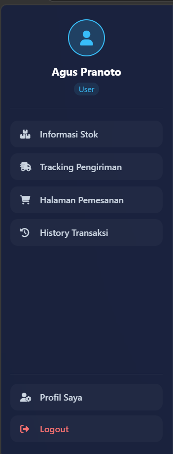
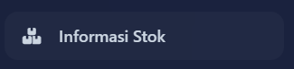
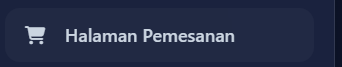
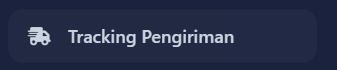
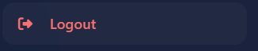

# UTSPemrogramanWeb
# Tugas UTS WEB
# LAPORAN PRAKTIKUM JAVASCRIPT DOM dan EVENT HANDLING
* **`Nama`** : Restu Aji Prasetyo
* **`NIM`**  : 312510034
* **`Kelas`**: I253C
* **`Dosen`**: Agung Nugroho S.Kom.,M.Kom.

# Berikut adalah hasil dari Praktikum dengan perubahan step by step nya mulai dari pembuatan laman dasar HTML sampai ke Javascript
# Pada bagian ini kita buat sampai ke tahap pemberian style/css nya
Langkah Pertama kita membuat bagian halaman dasar login seperti dibawah ini:

Selanjutnya membuat bagian modal awal untuk tombol untuk permintaan **Lupa Password dan Daftar Akun**

Membuat juga bagian modal awal untuk bagian **Peringatan Lupa *Input Email dan Lupa Input Password* serta sapaan *selamat datang sesuai nama email USER yang yang LOGIN***

Setelah pemberian CSS maka tampilan login final seperti dibawah ini, tinggal membuat bagian JavaScript untuk menarik data dari data javascript yang sudah diberikan dosen dan kita modifikasi.

Berikut Tampilan untuk **Input Lupa Password**

dan juga dibawah ini adalah tampilan ketika Input **Daftar akun baru**

Lanjut pada bagian Halaman kedua yakni kita membuat halaman dasar untuk **Halaman Dashboard** seperti dibawah ini, baian sidebar juga masih belum rapi karena belum diberi sentuhan CSS.

Selanjutnya membuat modal tampilan ringkasan untuk **Total Jenis Buku, Total Stock Buku, serta Total Pengiriman berjalan.**

Pada bagian selanjutnya kita memberi sentuhan CSS agar tampilan dashboard makin menarik sebelum memberikannya javascript juga

Berikut adalah Tampilan Dashboard ketika full window

dan dibawah ini adalah tampilan Dashboard ketika minimize window.

Pada bagian ketiga kita membuat dasar untuk **Halaman Stok Buku.**

Agar lebih menarik kita beri sentuhan CSS agar pengunjung web lebih nyaman. Pada langkah ini data javascript dan script untuk menarik data belum dibuat, maka tampilannya akan tampak seperti dibawah ini.

Pada bagian keempat kita membuat dasar untuk **Halaman Checkout** seperti dibawah ini.

Selanjutnya kita memberi sentuhan style inline pada bagian option serta warna angka total pembayaran.

Setelah itu kita lanjut untuk memberikan sentuhan style secara total pada bagian halaman Checkout ini sebelum pemberian Javascript.

Pada bagian kelima kita harus membuat dasar untuk halaman **pelacakan status pengiriman atau Tracking.**

Setelah itu kita beri stylenya agar lebih menarik untuk dilihat.

 # 
 # Pada bagian ini kita mulai memberikan javascript dan menghubungkannya dengan data.js yang telah diberikan oleh Dosen
 Selanjutnya setelah pemberiann Script untuk membuat web ini lebih interaktif dan dimanipulasi dengan mengambil data yang ada dari data.js yang telah diberikan, maka sekarang kita lihat tahapan selanjutnya untuk trial.
Pertama kita coba untuk bagian input Lupa Password seperti dibawah ini.

Dan hasilnya setelah klik **Kirim Intruksi** maka akan muncul pesan seperti berikut yaitu *Intruksi reset password telah dikirim sesuai dengan email yang dinput*.

Kedua kita akan coba input pada bagian **Daftar Akun**

Setelah klik **Daftar Sekarang** maka akan muncul pesan popup yang memberitahukan bahwa *Pendaftaran akun atas nama tsb berhasil*.

Untuk selanjutnya kita coba pada saat email kosong kita klik **Login**.

Maka nantinnya akan muncul popup peringatan untuk **Masukkan email dulu bro/sist**

ketika email yang diisi invalid pun kolom tersebut akan memperingatkan agar diisi email yang sesuai.

Lalu, kita coba juga untuk membuat agar saat password belum diisi juga akan muncul popup peringatan nantinya.

Maka akan muncul popup peringatan seperti dibawah ini **Masukkan Password juga ya bro/sis

kita buat agar ketika input password salah akan muncul peringatan

Peringatan **Email/Password salah** seperti dibawah ini.

Selanjutnya kita Login dengan email dan password yang benar

maka setelah klik login akan muncul sapaan seperti dibawah ini

Setelah itu akan mendapatkan popup informasi ketika login berhasil

Berikut adalah Tampilan Menu Dashboard untuk **User Restu**

Berikutnya kita coba juga untuk login menggunakan data **Siti**

Login Siti berhasil

Tampilan Menu Dashboard untuk **User Siti**

Selanjutnya kita login dengan data **User agus**

Login dengan data **user agus** berhasil

Tampilan menu Dashboard untuk user Agus

Pada bagian Sidebar sendiri terdapat beberapa menu untuk dashboardnya antara lain **Informasi Stok**,**Halaman Pemesanan**,**Tracking**, dan **history**

kita juga bisa masuk ke profil usernya melalui klik tombol **Profil** dibagian kiri bawah sidebar.

Berikut adalah Tampilan identitas Profil secara lengkap

dan juga kita bisa melakukan perubahan profil untuk **user agus**

popup notifikasi yang memberi tahu bahwa perubahan profil berhasil dilakukan

Berikut adalah tampilan baru setelah melakukan perubahan profil pada **user agus**

Untuk Halaman selanjutnya yaitu **Halaman Stok** kita bisa klik pada bagian sidebar yaitu **Informasi Stok**

Setelah **data.js** telah dimasukkan dan dibuat **script** untuk bagian halaman stok ini agar **data.js** dapat ditarik dan dimuat pada halaman ini maka akan muncul tampilannya seperti dibawah ini

Pada halaman ini juga bisa dilakukan untuk penambahan stok baru melalui kolom input stok seperti dibawah

Ketika penambahan stok berhasil maka akan muncul notifikasi popup bahwa *Buku baru telah berhasil ditambahkan ke katalog*

Berikut adalah tampilan ketika stok telah berhasil diinput ke dalam katalog.

Berikutnya untuk **Halaman Pemesanan/Checkout** kita bisa klik pada bagian kiri sidebar

Setelah pemberian **script** untuk menarik data dari **data.js** maka tampilan memilih buku akan tampil seperti dibawah ini.

Ketika akan Checkout pula saya buat untuk bagian pengisian nomor Handphome tidak bisa diisi kurang dari 10 karakter, karena rata-rata karakter nomor handphone itu minimal 10 dan kemungkinan maksimal yaitu 13 karakter.

Dibuat juga popup notifikasi untuk memilih buku terlebih dahulu ketika buku belum dipilih namun user sudah klik tombol checkout.

Maka ketika checkout belum memilih buku maka popup peringatan tersebut akan muncul

Dibawah ini adalah percobaan checkout melebihi batas stok yang tersedia dari stok yang ada, stok buku *Pengantar Ilmu Komunikasi* yaitu 548 pcs namun user checkout sebanyak 600 pcs.

Maka popup peringatan bahwa stok tidak mencukupi akan muncul dan memberi tahu stok yang tersedia pula saat itu.

Untuk yang terakhir kita melakukan checkout dengan format dan porsi yang benar

Maka ketika klik **Konfirmasi & Buat Pesanan** akan berhasil dan muncul popup bahwa checkout berhasil dan keterangan sesuai data checkout yang dilakukan. Setelah klik **OK** maka halaman akan langsung melempar kembali ke bagian Menu Dashboard

Selanjutnya pada bagian **Halaman Tracking** kita bisa klik pada menu **Tracking** dibagian sidebar

Setelah dilakukan penambahan **data.js** dan dibuat **script.js** untuk menarik dari data yang ada di dalam **data.js** maka, ketika di-inputkan nomor resi yang sesuai dengan data yang ada, lalu klik **Cari** maka data **tracking** akan tampil pada **Halaman tracking** tersebut.

Kita cek juga untuk data tracking dengan resi **20230013**

Selain *nomor pengiriman* yang ada dalam data maka trackinng tidak ditemukan.

Untuk yang terakhir kita bisa melakukan Logout dengan klik tombol **Logout** pada bagian pojok kiri bawah sidebar.

Konfirmasi Logout melalui popup

Klik **OK** dan logout akan berhasil dilakukan.

